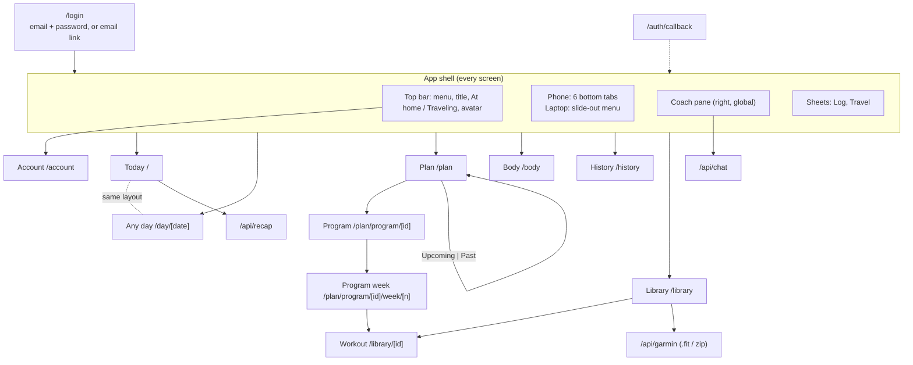

# Cairn - site map and components

> **Keep this current.** Any change to a route, a tile on a screen, a shared component, the nav, a coach tool,
> an API route or a database migration updates this file in the same change. Add a line to the
> [Changelog](#9-changelog) at the bottom. (The rule is also in `CLAUDE.md`, so cloud sessions follow it too.)

As of 2026-11-28, migrations 0001-0008. (0008 `program_weeks` must be applied in Supabase for saved program weeks; everything else works without it.)

---

## 1. Site map

## 2. Frame and navigation

| Piece | Where | Notes |
|---|---|---|
| Top bar | `Shell.tsx` | menu button (laptop only), "Cairn", At home / Traveling switch, avatar to `/account` |
| Bottom tabs (phone) | `Shell.tsx` | Today, Coach (opens the pane), Body, Plan, History, Library |
| Slide-out menu (laptop) | `Shell.tsx` | pushes the page right, stays open while navigating, remembered in `localStorage` (`cairn.menu`) |
| Coach pane | `CoachDrawer.tsx` + `Chat.tsx` | right side, pushes the page left; stays mounted so the chat keeps its state; Esc closes |
| Log sheet | `LogSheet.tsx` (opened by `openLog`) | workout(s), date, vert, pain, feel, notes; also used for rest days and back-dated entries |
| Travel sheet | `TravelSheet.tsx` (opened by `openTravel`) | gear (gym / bodyweight), jogging, return date; sends the answers to the coach |
| App state | `AppProvider.tsx` (`useApp()`) | `data`, `sb`, `uid`, `today`, `status`, `run`, `openLog`, `openTravel`, `saveProposal`, `askCoach`, `coachOpen`, `outbox` |

Auth: `src/proxy.ts` sends signed-out visitors to `/login`; `(app)/layout.tsx` loads everything once (`loadAll`) and hands it to `AppProvider`.

## 3. Screens and their tiles

### Today `/` and any day `/day/[date]` (one component: `DayView.tsx`)
Same layout for past, today and future; only the contents change. Future days grey out the check-in.

| Tile | Component | Shown |
|---|---|---|
| Header: ‹ day ›, Back to today, Ask coach | `DayView` | always |
| Day strip (7 tiles; rest = dashed grey, tour = accent, selected = filled) | `DayView` | always |
| Up next (calm-down / plan item / no plan / week done) | `DayView` | today |
| Done card (what was logged, rundown) | `DayView` | past days |
| Planned card (disabled Done / Skip, rundown) | `DayView` | future days |
| Program week banner ("Build this week") | `ProgramWeekBanner` in `Programs.tsx` | today |
| Tour green light | `DayView` + `rules.greenLight` | today, only when a tour is close |
| After-tour check-in banner | `DayView` | morning after a tour |
| Quick check-in (overall feel + one tap per pain area, exact 0-10, add area) | `QuickCheck.tsx` | all days (disabled in the future) |
| AI recap with next steps | `Recap.tsx` -> `/api/recap` | today |
| Log something else (tour / workout / rest) | `DayView` | today |
| Notes (that day's entries, editable) | `RecentList.tsx` | other days |

### Plan `/plan` (Upcoming | Past)
| Tile | Component | Notes |
|---|---|---|
| Program week banner | `ProgramWeekBanner` | |
| Programs (active program, phase bar, Check in / Pause / This week, saved bank) | `Programs.tsx`, `PhaseBar.tsx` | the title and each phase link into the program and its weeks |
| Goals | `plan/page.tsx` | text the coach keeps (`profiles.goals`) |
| This week / Travel set (checklist, tap a number to mark done) | `plan/page.tsx` | |
| Next-tour banner | `plan/page.tsx` | always findable here |
| Where are you training? (trip details, edit, start over) | `plan/page.tsx` | |
| "<primary area> flared?" / Calm-down | `plan/page.tsx` | follows the person's primary pain area; the flared card only shows if they have one |
| Log something else | `LogShortcuts` (`ui.tsx`) | same block as Today |
| **Past:** full log, day-grouped, editable | `RecentList.tsx` | up to 400 days |

### Program `/plan/program/[id]`
Overview (goal, progress meter, facts: type, started, event day, days a week, session length, equipment; "done when" checks for milestones; Build this week / Change program / Pause / Mark done) - Phases (the clickable phase bar, then one tile per phase with its focus and week links) - Weeks (every week with dates, "Planned" or "Current plan", and This week / Done / Upcoming).

### Program week `/plan/program/[id]/week/[n]`
Where the week sits (phase, focus, dates, status, planned sessions logged, sessions, average pain, tour vert) - Logged this week (links to each day) - The plan: one block per planned day with a `WorkoutTile` for each workout (tap to open the workout) and a "Logged" tag when a session was logged for it. Each logged session counts for one planned day. If the week was saved (migration 0008) it shows "as planned"; this week with no saved copy shows the current plan with "Keep this week in the program". Weeks past the program's length say so. Prev / next week arrows.

### Body `/body`
Pain check per area (0-10, trend, "mostly better" to stop tracking) - `PainCard.tsx` + `PainChart.tsx`; Recent notes; How you've felt; Resolved areas (track again).

### History `/history` (range: 4 weeks default, Quarter, Year, Max; starts at the first tracked day)
Four KPI tiles (`StatTile`: sessions, active days, green-zone %, tour vert or streak) - Sessions per week (`WeeklyBars`) - What you trained (`MixBars`) - Pain: sessions vs daily checks (`PainTrend`) - Activity heatmap (`Heatmap`) - Body areas with sparklines (`Spark`) - Tours table - Log (`RecentList`). Charts and tooltips: `charts/Charts.tsx`, `charts/Tip.tsx`; numbers: `lib/stats.ts`.

### Library `/library`
Watch card (bundle the week's `.fit` files, "update watch" flags) - search + category pills - `WorkoutTile` rows that expand to the rundown with Change with coach, Download .fit, History and "Open the full page". Components: `WorkoutTile.tsx`, `Watch.tsx` (`WatchCard`, `WatchChip`, `useGarminDownload`), `WorkoutHistory.tsx`.

### Workout `/library/[id]`
One workout in full: tags (category, version, yours/shared, "update watch"), the rundown, Change with coach and Download .fit, **Where it's used** (plan items that include it), **When you did it** (your log entries for it), **Version history** (view and restore).

### Account `/account` and Login `/login`
Account: signed-in line, sign out, set a password. Login: password form, or "email me a link".

## 4. Shared components

| Component | What it is | Used by |
|---|---|---|
| `AppProvider` | context + data reload (`run`) + proposal saving + sheets | everything |
| `Shell` | top bar, tabs, slide-out menu | `(app)/layout` |
| `DayView` | the day screen | `/`, `/day/[date]` |
| `ui.tsx` | the small shared pieces: `PainChip` (a value), `Tag` (a label), `SectionCard`, `PageHeader`, `AskCoachButton`, `ConfirmButton`, `PainPicker`, `FeelPicker`, `LogShortcuts` | every screen |
| `lib/format.ts` | the one set of date helpers (`shortDate`, `weekday`, `dayHeading`, `dateRange`, ...) | everywhere |
| `WorkoutTile` | one way to show a workout: `row` (expands, Library) and `card` (links to the workout page); also `WorkoutActions` and `WorkoutRundowns` | Library, program week, DayView |
| `RecentList` | day-grouped log with rest-day rows and the full entry editor (delete lives in the editor) | DayView, Plan, History |
| `Rundown` | workout set/circuit tiles | WorkoutTile, WorkoutHistory, workout page |
| `Collapsible` | "Show/Hide workout", closed by default on phones | WorkoutRundowns |
| `QuickCheck` | one-tap daily check-in | DayView |
| `PainCard` | per-area pain card (uses `PainLine`) | Body |
| `FeelPill` / `VertPill` | Rough / OK / Good / Great and vert pills | DayView, RecentList, program pages |
| `Programs` / `PhaseBar` | program card, saved bank, phase strip (links when given `hrefFor`); `useProgramActions`, `CriteriaList` | Plan, program page, DayView (banner), ProposalCard |
| `ProposalCard` | coach suggestions as before/after cards with Save / Discard (workout, plan, program, program update) | Chat |
| `Recap` | AI recap tile, cached per device | DayView |
| `Watch` | Garmin download hook, week bundle card, "on watch" chip | Library |
| `WorkoutHistory` | version list and restore | Library |
| `Chat` / `CoachDrawer` / `voice.ts` | saved conversation, thinking indicator, voice in and out | AppProvider |
| `charts/*` | `StatTile`, `WeeklyBars`, `MixBars`, `PainTrend`, `PainLine`, `Heatmap`, `Spark`, tooltip | History, Body |

## 5. Coach and APIs

| Route | Purpose |
|---|---|
| `POST /api/chat` | the coach (Claude, tool use). Saves every message to `coach_messages`. |
| `GET /api/garmin` | builds a `.fit` (one workout) or a `.zip` (the week) |
| `GET /api/recap` | the short AI recap shown on Today |
| `GET /auth/callback` | magic-link landing (`token_hash` or PKCE `code`) |

Coach tools (`/api/chat`): `log_session`, `pain_check`, `add_pain_area`, `propose_workout`, `propose_plan_change`, `propose_program`, `propose_program_update`, `set_program_status`, `set_goals`, `review_training`, `set_phase`, `set_travel`, `skip_up_next`, `start_next_week`. Anything that changes a workout, plan or program is a **proposal**: it shows as a card and saves only when the person taps Save.

## 6. Data

| Migration | Adds |
|---|---|
| 0001 | `profiles`, `workouts`, `plans`, `plan_state`, `log_entries` (+ RLS, signup trigger) |
| 0002 | `pain_areas`, `pain_checks`; new users start with an empty plan |
| 0003 | `plan_state.travel_info` |
| 0004 | `daily_checkins`, `coach_messages` |
| 0005 | `workout_versions`, `garmin_exports`, `workouts.version` |
| 0006 | `profiles.goals` |
| 0007 | `programs`, `plans.program_id / program_week` |
| 0008 | `program_weeks` (every program week kept as planned; saved when a plan is written for a program week) |

Library modules (`src/lib`): `actions.ts` (all writes, shared by browser and coach), `rules.ts` (up next, green light, dates), `stats.ts` (History numbers), `format.ts` (dates), `programs.ts` / `programInput.ts` (program position, `phaseAtWeek`, `weekRange`, `weekActivity`, phases, "done when" checks), `proposals.ts`, `review.ts` (digest for the coach), `types.ts`, `garmin/*` (`.fit` writer, steps, zip, status).

## 7. UI conventions
- Page: `.page` > `PageHeader` (h1, the page's control, and the coach button) > `.two` columns of `.stack`s of `SectionCard`s. A few cards stay hand-written because their header is special (the Up next card, quick check-in, recap, stat tiles, login).
- Small labels: `PainChip` / `FeelPill` / `VertPill` show a **value**; `Tag` shows a **label** (category, status).
- Pain colours: 0-3 green, 4-6 amber, 7-10 red (`painClass`). Feel: Rough red, OK grey, Good green, Great solid green.
- Rest days are grey and dashed; tours use the accent colour; days before tracking began are faded.
- Destructive actions (deletes, "start over") use `ConfirmButton`: tap, then tap again. No browser pop-ups. Reversible actions (Pause, Back to calm-down) don't ask. Nothing the coach suggests saves without a tap.
- Charts: brand teal for single-series; validated blue / orange (`--s1`, `--s2`) for two series; direct labels plus a "View as table".
- Dates: use `lib/format.ts` (browser locale). Text sent to the coach is built server-side in `en-US` on purpose. History starts at the first tracked day, never before it.
- Nothing in the UI or code may assume one person: no hip, ski or SKI1 wording outside that person's own data (shared library workouts are data, not UI).

## 8. Cleanup backlog
Done (2026-11-28):
- [x] One `WorkoutTile` (row + card) for Library and the program week; DayView uses `WorkoutRundowns`. The coach's diff card and the version viewer stay separate on purpose (they show differences, not a workout)
- [x] One `lib/format.ts` for dates (the remaining `en-US` spots are server-side coach text on purpose)
- [x] Shared `PainPicker` / `FeelPicker`; one pain line chart (`PainLine`); `PainChart.tsx` removed
- [x] One `ConfirmButton`; the browser `confirm()` calls are gone
- [x] One label family: `PainChip` / `FeelPill` / `VertPill` (values) and `Tag` (labels)
- [x] `SectionCard` and `PageHeader` everywhere they fit; the coach button is "Ask coach" on every page, with a page-specific prompt
- [x] "Log something else" is one shared block (`LogShortcuts`)
- [x] Dave-specific defaults removed: "<area> flared?" follows the primary pain area, "Log a workout" starts on the last workout logged, the log sheet says "Pain during", the chat placeholder uses a real workout (checked by signing in as a brand-new member: no hip wording on any screen)
- [x] Program pages with clickable phases, a week page and a workout page; program weeks kept (0008)

Still open:
- [ ] Three lists of the same log (Plan > Past, History > Log, Body > Recent notes): keep one editable list
- [ ] Slim the Plan page (program, goals, week, trip, rehab mode, log shortcuts)
- [ ] 89 inline `style={{...}}` objects (26 in the charts) should become classes
- [ ] Hand-written cards that could use `SectionCard` with a richer header: QuickCheck, Recap, StatTile
- [ ] Plan ahead: let the coach draft several future program weeks at once (the week page can already show them once saved)
- [ ] `review.ts` still has its own small date helpers (server-side, kept so the coach text is stable)

## 9. Changelog
- 2026-11-28 - Initial site map and component inventory; cleanup backlog from the audit.
- 2026-11-28 - Shared components (`ui.tsx`, `format.ts`, `WorkoutTile`); new routes `/library/[id]`, `/plan/program/[id]`, `/plan/program/[id]/week/[n]`; clickable phases; migration 0008 `program_weeks`; Dave-specific defaults removed; backlog updated.
