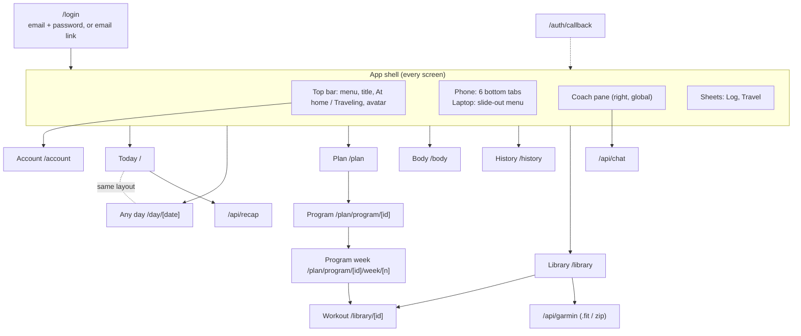

# Cairn - site map and components

> **Keep this current.** Any change to a route, a tile on a screen, a shared component, the nav, a coach tool,
> an API route or a database migration updates this file in the same change. Add a line to the
> [Changelog](#9-changelog) at the bottom. (The rule is also in `CLAUDE.md`, so cloud sessions follow it too.)

As of 2026-11-28, migrations 0001-0010. (0008 `program_weeks` and 0009 draft weeks + week versions must be applied in Supabase for planning ahead; without them the app falls back to the old behavior and the program pages say so.)

---

## 1. Site map

## 2. Frame and navigation

| Piece | Where | Notes |
|---|---|---|
| Top bar | `Shell.tsx` | menu button (laptop only), "Cairn", At home / Traveling switch, avatar to `/account` |
| Bottom tabs (phone) | `Shell.tsx` | Today, Coach (opens the pane), Body, Plan, History, Library |
| Slide-out menu (laptop) | `Shell.tsx` | pushes the page right, stays open while navigating, remembered in `localStorage` (`cairn.menu`) |
| Coach pane | `CoachDrawer.tsx` + `Chat.tsx` | right side, pushes the page left; stays mounted so the chat keeps its state; Esc closes |
| Log sheet | `LogSheet.tsx` (opened by `openLog`) | workout(s), date, vert, pain, feel, notes; also used for rest days and back-dated entries |
| Travel sheet | `TravelSheet.tsx` (opened by `openTravel`) | gear (gym / bodyweight), jogging, return date; sends the answers to the coach |
| App state | `AppProvider.tsx` (`useApp()`) | `data`, `sb`, `uid`, `today`, `status`, `run`, `openLog`, `openTravel`, `saveProposal`, `askCoach`, `coachOpen`, `outbox` |

Auth: `src/proxy.ts` sends signed-out visitors to `/login`; `(app)/layout.tsx` loads everything once (`loadAll`) and hands it to `AppProvider`.

## 3. Screens and their tiles

### Today `/` and any day `/day/[date]` (one component: `DayView.tsx`)
Same layout for past, today and future; only the contents change. Future days grey out the check-in.

| Tile | Component | Shown |
|---|---|---|
| Header: ‹ day ›, Back to today, Ask coach | `DayView` | always |
| Day strip (7 tiles; rest = dashed grey, tour = accent, selected = filled) | `DayView` | always |
| Up next (calm-down / plan item / no plan / week done) | `DayView` | today |
| Done card (what was logged, rundown) | `DayView` | past days |
| Planned card (disabled Done / Skip, rundown) | `DayView` | future days |
| Program week banner ("Use the draft" / "Adjust it first" / "Build this week") | `ProgramWeekBanner` in `Programs.tsx` | today (full width, right under the day strip) |
| Plan-ahead / re-plan suggestion (reasons, button to the coach, "Not now") | `ProgramNudge.tsx` | today |
| "You're set" tile: weeks mapped out (dots) + a peek at the next week | `ProgramAhead.tsx` | today, when a plan is in place and no suggestion is showing |
| Tour green light | `DayView` + `rules.greenLight` | today, only when a tour is close |
| After-tour check-in banner | `DayView` | morning after a tour |
| Quick check-in (overall feel + one tap per pain area, exact 0-10, add area) | `QuickCheck.tsx` | all days (disabled in the future) |
| AI recap with next steps | `Recap.tsx` -> `/api/recap` | today |
| Log something else (a tour / a workout / rest day): a row inside the Up next / Done card (`LogShortcuts inline`) | `DayView` | today |
| Notes (that day's entries, editable) | `RecentList.tsx` | other days |

### Plan `/plan`
What you're working toward, this week, and the two switches. Everything you've done lives in History.

| Tile | Component | Notes |
|---|---|---|
| Program week banner | `ProgramWeekBanner` | only when the active program has moved to a week with no plan (or a drafted one) |
| Plan-ahead / re-plan suggestion | `ProgramNudge` | only when the app thinks it helps (see Program planning rules) |
| "You're set" tile | `ProgramAhead` | instead of the suggestion, when weeks ahead are planned |
| Programs (active program, phase bar, Check in / Pause / This week, saved bank) | `Programs.tsx`, `PhaseBar.tsx` | the title and each phase link into the program and its weeks |
| This week / Travel set (checklist, tap a number to mark done) + link to History | `plan/page.tsx` | left column |
| Next-tour banner | `plan/page.tsx` | right column, only when relevant |
| Goals | `plan/page.tsx` | text the coach keeps (`profiles.goals`) |
| **Right now**: where you're training (home or trip details, edit, start over) and the rehab mode for the primary pain area ("Flared? Back to calm-down" / "Start the plan") | `RightNow.tsx` | the rehab row only shows for someone with a primary pain area (or in calm-down) |

### Program `/plan/program/[id]` and week `/plan/program/[id]/week/[n]`
One layout (`program/[id]/layout.tsx`) so the top never changes while you move around; only the week below swaps.
1. **Program** card: status, how it's going (with reasons), progress, goal, actions (Build this week / Use the draft / Check in, Adjust this week, Plan ahead, Re-plan the rest, Change program, Pause, ...) and a "Program details" fold (type, dates, equipment, notes, "done when" checks).
2. **Phases** (`PhaseExplorer`): the phase bar (the phase you're viewing is highlighted), then that phase's goal, "Coming out" (how you should feel), its week chips (dot = drafted ahead) and chips for the workouts planned in it (library ones link to the workout).
3. **Week** (`WeekView`, the landing is the current week): heading with prev/next; "This week" (status, stats, the redraft / adjust buttons - the coach does the rebuilding), Logged this week, Versions; and **The plan**: one short row per day, tap a day to open its workout tiles. A drafted week shows a Draft tag and the coach's "Why".
The "You're set" tile on Today and Plan is the way in: its title, each week dot and "See the whole plan" link here.

### Body `/body`
Pain check per area (0-10, trend, "mostly better" to stop tracking) - `PainCard.tsx` + `PainChart.tsx`; Recent notes; How you've felt; Resolved areas (track again).

### History `/history` (range: 4 weeks default, Quarter, Year, Max; starts at the first tracked day)
Four KPI tiles (`StatTile`: sessions, active days, green-zone %, tour vert or streak) - Sessions per week (`WeeklyBars`) - What you trained (`MixBars`) - Pain: sessions vs daily checks (`PainTrend`) - Activity heatmap (`Heatmap`) - Body areas with sparklines (`Spark`) - Tours table - Log (`RecentList`). Charts and tooltips: `charts/Charts.tsx`, `charts/Tip.tsx`; numbers: `lib/stats.ts`.

### Library `/library`
Watch card (bundle the week's `.fit` files, "update watch" flags) - search + category pills - `WorkoutTile` rows that expand to the rundown with Change with coach, Download .fit, History and "Open the full page". Components: `WorkoutTile.tsx`, `Watch.tsx` (`WatchCard`, `WatchChip`, `useGarminDownload`), `WorkoutHistory.tsx`.

### Workout `/library/[id]`
One workout in full: tags (category, version, yours/shared, "update watch"), the rundown, Change with coach and Download .fit, **Where it's used** (plan items that include it), **When you did it** (your log entries for it), **Version history** (view and restore).

### Account `/account` and Login `/login`
Account: signed-in line, sign out, set a password. Login: password form, or "email me a link".

## 4. Shared components

| Component | What it is | Used by |
|---|---|---|
| `AppProvider` | context + data reload (`run`) + proposal saving + sheets | everything |
| `Shell` | top bar, tabs, slide-out menu | `(app)/layout` |
| `DayView` | the day screen | `/`, `/day/[date]` |
| `ui.tsx` | the small shared pieces: `PainChip` (a value), `Tag` (a label), `SectionCard`, `PageHeader`, `AskCoachButton`, `ConfirmButton`, `PainPicker`, `FeelPicker`, `LogShortcuts` | every screen |
| `lib/optimistic.ts` | pure "what the screen looks like the instant you tap" helpers; pass one as the 3rd argument of `run(...)` (check-ins, ticks, phase, travel off, entry edit/delete, areas, program pause/start/delete). A failed save reloads the real data | everywhere `run` is used |
| `lib/format.ts` | the one set of date helpers (`shortDate`, `weekday`, `dayHeading`, `dateRange`, ...) | everywhere |
| `WorkoutTile` | one way to show a workout: `row` (expands, Library) and `card` (links to the workout page); also `WorkoutActions` and `WorkoutRundowns` | Library, program week, DayView |
| `RecentList` | day-grouped log with rest-day rows and the full entry editor (delete lives in the editor) | DayView, Plan, History |
| `Rundown` | workout set/circuit tiles | WorkoutTile, WorkoutHistory, workout page |
| `Collapsible` | "Show/Hide workout", closed by default on phones | WorkoutRundowns |
| `QuickCheck` | one-tap daily check-in | DayView |
| `PainCard` | per-area pain card (uses `PainLine`) | Body |
| `FeelPill` / `VertPill` | Rough / OK / Good / Great and vert pills | DayView, RecentList, program pages |
| `RightNow` | where you're training + rehab mode (one card) | Plan |
| `Programs` / `PhaseBar` | program card, saved bank, phase strip (links when given `hrefFor`); `useProgramActions`, `CriteriaList` | Plan, program page, DayView (banner), ProposalCard |
| `ProposalCard` | coach suggestions as before/after cards with Save / Discard (workout, plan, program, program update, program weeks: plan ahead / re-plan) | Chat |
| `Recap` | AI recap tile, cached per device | DayView |
| `Watch` | Garmin download hook, week bundle card, "on watch" chip | Library |
| `VersionList` | one version list (revision, date, note, changed rows, restore); shared by workout and week history | WorkoutHistory, WeekHistory |
| `WorkoutHistory` | workout versions and restore | Library |
| `WeekHistory` | program-week revisions, changed days marked, restore | Program week |
| `WeekView` / `PhaseExplorer` | the week below the program header; the phases + their workouts | program pages |
| `PlanItems` | `PlanDayRow` (a day on one short row, tap for tiles), `PlanDayTile` (a day with a tile per workout) and `PlanItemsCompact` (days list with Changed tags) | Program week, ProposalCard |
| `WeekStatus` | `WeekStatusTag` (On track / Behind / Done ...) and `WeekSourceTag` (Draft / Current plan / As planned) | Program pages |
| `ProgramNudge` | the "plan ahead" / "re-plan" suggestion banner | Today, Plan |
| `ProgramAhead` | the celebratory "plan is in place" tile (`programAhead` in `programWeeks.ts`) | Today, Plan |
| `Chat` / `CoachDrawer` / `voice.ts` | saved conversation, thinking indicator, voice in and out | AppProvider |
| `charts/*` | `StatTile`, `WeeklyBars`, `MixBars`, `PainTrend`, `PainLine`, `Heatmap`, `Spark`, tooltip | History, Body |

## 5. Coach and APIs

| Route | Purpose |
|---|---|
| `POST /api/chat` | the coach (Claude, tool use). Saves every message to `coach_messages`. |
| `GET /api/garmin` | builds a `.fit` (one workout) or a `.zip` (the week) |
| `GET /api/recap` | the short AI recap shown on Today (includes the plan-ahead / re-plan suggestion) |
| `GET /auth/callback` | magic-link landing (`token_hash` or PKCE `code`) |

Coach tools (`/api/chat`): `log_session`, `pain_check`, `add_pain_area`, `propose_workout`, `propose_plan_change`, `propose_program`, `propose_program_update`, `propose_program_weeks` (plan ahead / re-plan: later weeks only, saved as drafts), `set_program_status`, `set_goals`, `review_training`, `set_phase`, `set_travel`, `skip_up_next`, `start_next_week`. Anything that changes a workout, plan or program is a **proposal**: it shows as a card and saves only when the person taps Save.

## 6. Data

| Migration | Adds |
|---|---|
| 0001 | `profiles`, `workouts`, `plans`, `plan_state`, `log_entries` (+ RLS, signup trigger) |
| 0002 | `pain_areas`, `pain_checks`; new users start with an empty plan |
| 0003 | `plan_state.travel_info` |
| 0004 | `daily_checkins`, `coach_messages` |
| 0005 | `workout_versions`, `garmin_exports`, `workouts.version` |
| 0006 | `profiles.goals` |
| 0007 | `programs`, `plans.program_id / program_week` |
| 0008 | `program_weeks` (every program week kept as planned; saved when a plan is written for a program week) |
| 0010 | `activities` (imported watch activities, one row each; gym strength lives only here) |
| 0009 | `program_weeks.status` (draft / live), `revision`, `note`; `program_week_versions` (written by trigger, like workout versions) |

Garmin history import (private data in git-ignored `data/garmin-watch`, `data/garmin-export`): `python3 scripts/garmin_sessions.py <Activity folder> data/garmin-export/activities.json`, then `npm run garmin:import` (dry run) / `-- --apply`. Skiing, running, biking, hiking, swimming become log entries (notes start with "Garmin"; anything already logged that day is left alone); gym strength stays out of the log. Re-runnable.

Library modules (`src/lib`): `actions.ts` (all writes, shared by browser and coach), `rules.ts` (up next, green light, dates), `stats.ts` (History numbers), `format.ts` (dates), `programWeeks.ts` (pure rules: week plan, matching logged sessions to planned days, week status, program health, the nudge, coach prompts), `programs.ts` / `programInput.ts` (program position, `phaseAtWeek`, `weekRange`, `weekActivity`, phases, "done when" checks), `proposals.ts`, `review.ts` (digest for the coach), `types.ts`, `garmin/*` (`.fit` writer, steps, zip, status).

### Program planning rules
- **Drafts never touch the live plan.** The coach plans later weeks only (after the current one) as `draft` rows; a draft becomes the plan when its week arrives ("Use the draft") or when the person adopts it early. Re-planning replaces drafts and bumps the revision; nothing is deleted.
- **Week status.** Finished week: 80%+ of planned days logged = Done, 50%+ = Partly done, less = Missed. Current week: compared with how much should be done by now - more than one day behind = Behind, more than one ahead = Ahead, else On track. Pain over 3 during a session adds a flag. Each logged session counts for one planned day.
- **Suggestions.** `programNudge` offers "plan ahead" when no later week is planned, and "re-plan" when the program is behind or flagged and the drafts weren't redone since. Re-plan is always the person's tap (or the coach's offer); never automatic. "Not now" is remembered on the device.
- **Tone.** The person is fluid: a plan in place is good news. Show it (`ProgramAhead`), never nag about a built week, and the coach celebrates wins and nudges one small step without guilt for misses or changes.
- Without migration 0009 (`weekPlansReady` false) the planning features hide and the program pages say a database update is needed.

## 7. UI conventions
- Page: `.page` > `PageHeader` (h1, the page's control, and the coach button) > `.two` columns of `.stack`s of `SectionCard`s. A few cards stay hand-written because their header is special (the Up next card, quick check-in, recap, stat tiles, login).
- Styling: no one-off `style={{...}}`. Use the utility classes in `globals.css` (`m0`, `muted`, `small`, `nowrap`, `gap-6`, `self-start`, `between`, `strike`, `tbl`, `textinput`, ...) or a named component class. Inline style is only for computed values (bar widths, `flex-grow` by weeks, tooltip position); there are 7 today.
- Small labels: `PainChip` / `FeelPill` / `VertPill` show a **value**; `Tag` shows a **label** (category, status).
- Pain colours: 0-3 green, 4-6 amber, 7-10 red (`painClass`). Feel: Rough red, OK grey, Good green, Great solid green.
- Rest days are grey and dashed; tours use the accent colour; days before tracking began are faded.
- Destructive actions (deletes, "start over") use `ConfirmButton`: tap, then tap again. No browser pop-ups. Reversible actions (Pause, Back to calm-down) don't ask. Nothing the coach suggests saves without a tap.
- Charts: brand teal for single-series; validated blue / orange (`--s1`, `--s2`) for two series; direct labels plus a "View as table".
- Dates: use `lib/format.ts` (browser locale). Text sent to the coach is built server-side in `en-US` on purpose. History starts at the first tracked day, never before it.
- Nothing in the UI or code may assume one person: no hip, ski or SKI1 wording outside that person's own data (shared library workouts are data, not UI).

## 8. Cleanup backlog
Done (2026-11-28):
- [x] One `WorkoutTile` (row + card) for Library and the program week; DayView uses `WorkoutRundowns`. The coach's diff card and the version viewer stay separate on purpose (they show differences, not a workout)
- [x] One `lib/format.ts` for dates (the remaining `en-US` spots are server-side coach text on purpose)
- [x] Shared `PainPicker` / `FeelPicker`; one pain line chart (`PainLine`); `PainChart.tsx` removed
- [x] One `ConfirmButton`; the browser `confirm()` calls are gone
- [x] One label family: `PainChip` / `FeelPill` / `VertPill` (values) and `Tag` (labels)
- [x] `SectionCard` and `PageHeader` everywhere they fit; the coach button is "Ask coach" on every page, with a page-specific prompt
- [x] "Log something else" is one shared block (`LogShortcuts`)
- [x] Dave-specific defaults removed: "<area> flared?" follows the primary pain area, "Log a workout" starts on the last workout logged, the log sheet says "Pain during", the chat placeholder uses a real workout (checked by signing in as a brand-new member: no hip wording on any screen)
- [x] Program pages with clickable phases, a week page and a workout page; program weeks kept (0008)
- [x] Plan page slimmed from 8 tiles in two tabs to 4 (Programs, This week, Goals, Right now): travel and rehab mode merged into `RightNow`, the duplicate "Log something else" and the Past tab removed
- [x] One editable full log (History > Log). Plan > Past is gone; the day page lists that day's entries and Body shows notes only
- [x] Inline styles: 90 down to 7, all computed (checked with a pixel diff of 9 pages before and after: identical)

Still open:
- [ ] Hand-written cards that could use `SectionCard` with a richer header: QuickCheck, Recap, StatTile
- [ ] Plan ahead: let the coach draft several future program weeks at once (the week page can already show them once saved)
- [ ] `review.ts` still has its own small date helpers (server-side, kept so the coach text is stable)

## 9. Changelog
- 2026-11-28 - Initial site map and component inventory; cleanup backlog from the audit.
- 2026-11-28 - Shared components (`ui.tsx`, `format.ts`, `WorkoutTile`); new routes `/library/[id]`, `/plan/program/[id]`, `/plan/program/[id]/week/[n]`; clickable phases; migration 0008 `program_weeks`; Dave-specific defaults removed; backlog updated.
- 2026-11-28 - Plan page slimmed to 4 tiles (new `RightNow`; Past tab and duplicate log shortcuts removed); inline styles 90 to 7 via utility classes, verified identical by pixel diff; backlog updated.
- 2026-11-28 - Plan ahead / re-plan / week status / week versions: migration 0009, `programWeeks.ts` rules, `propose_program_weeks` tool, `ProgramNudge`, `PlanItems`, `WeekStatus`, `VersionList`, `WeekHistory`; program and week pages updated; recap mentions the suggestion.
- 2026-11-28 - Program with a planned week no longer offers "Build this week" (Check in / Adjust this week / Use the draft instead); new `ProgramAhead` "you're set" tile; gentler re-plan copy; coach and recap encourage.
- 2026-11-28 - Program pages share one layout (program card + phases always on top; only the week changes); `PhaseExplorer` (goal, "coming out" feel, weeks, workouts per phase); short day rows; phases carry an optional `outcome`; program-row buttons one size; "You're set" tile is now an entry (links to each week).
- 2026-11-28 - Today: right column is Quick check-in > program tiles (banner / suggestion / "You're set") > Recap > Log something else; the "You're set" tile is slimmer.
- 2026-11-28 - Today: program tiles are full width right under the day strip, then the workout; right column is Quick check-in > Log something else > Recap. Quick check-in says "all set - update any time" (one per day, the last answer wins).
- 2026-11-28 - Instant taps: `run(fn, fail, optimistic)` and `lib/optimistic.ts`; check-ins, plan ticks, phase, At home, entry edit/delete, pain areas and program status update the screen immediately. Slower multi-step actions (log, skip, next week, use a draft) still wait for the save.
- 2026-11-28 - Today: "Log something else" moved inside the workout tile (Up next and Done cards) as one quiet row; the separate tile is gone.
- 2026-11-28 - Garmin history import: `scripts/garmin_sessions.py` (reads watch .fit session summaries), `scripts/garmin-import.mts`, migration 0010 `activities`; 83 activities (Jan-Nov 2026) imported as log entries.
